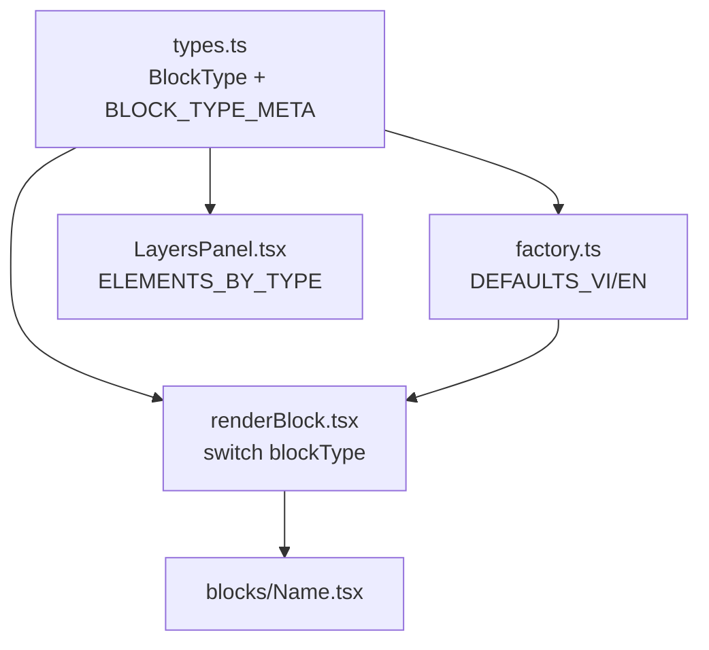
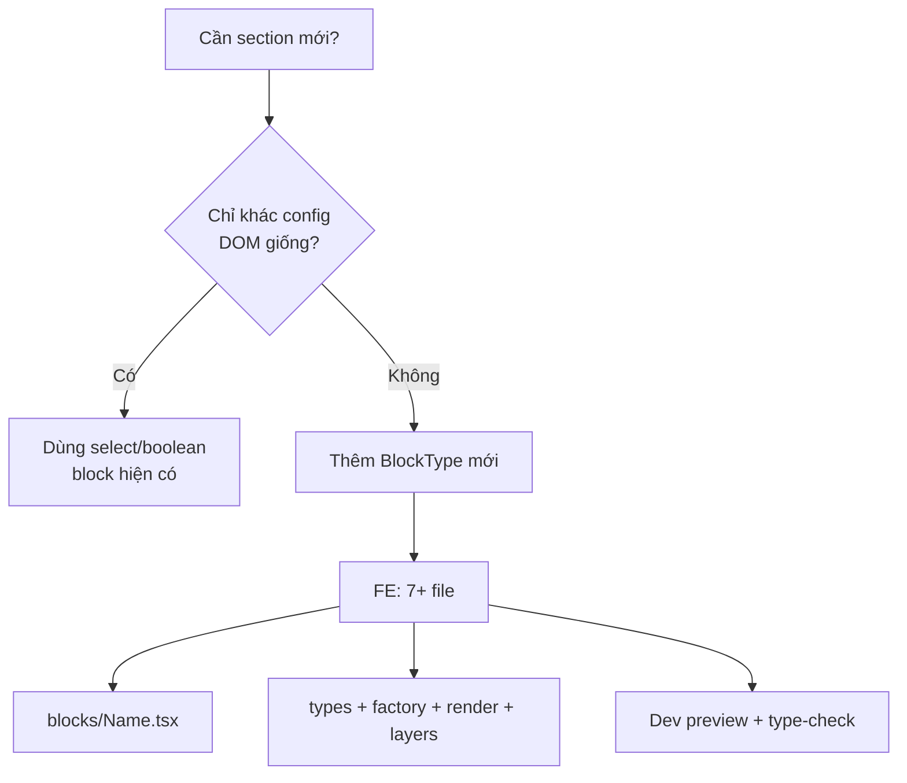
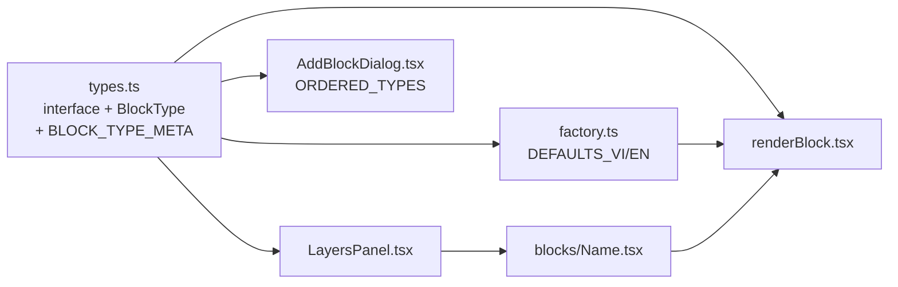

# Block Editor — Báo cáo trạng thái & chẩn đoán

**Ngày:** 2026-06-22  
**Phạm vi:** `src/` (bỏ qua `apps/`), tập trung `src/components/modules/block-editor`  
**Loại tài liệu:** Audit & chẩn đoán — **không** bao gồm task triển khai code

---

## 1. Executive Summary

1. **Quy mô lớn, registry tập trung:** ~100 `BlockType`, 96 block renderer + `renderBlock.tsx` dispatcher. Thêm block mới vẫn là quy trình manual 7+ file (`types.ts` → `factory.ts` → component → `renderBlock.tsx` → `LayersPanel.tsx`…).
2. **Styles** **chưa đồng bộ convention:** ~77% block có `@container`; Framer ports dùng nhiều inline `React.CSSProperties` + hex literal; 9 block nhúng `<style>` keyframes. Không có CSS modules hay styled-components.
3. **Component contract (data-block) đã hình thành** ở block mới (Mint*, Framer ports gần đây) nhưng **không universal:** ~88% dùng `composeStyle`; ~32 block thiếu `'use client'`; nhiều file vượt 250–700 LOC. Skill `rexer-component-style` áp dụng admin UI, **không** áp dụng landing blocks.
4. **Animation phân mảnh — chưa đồng bộ:** Ba mô hình song song (Motion system / Self-running / GSAP scroll). Chỉ 19 block dùng `useBlockMotion` contract; 13 block GSAP bypass contract; `_anim/` shared kit đã plan nhưng **chưa tồn tại**. `framer-motion` đã loại bỏ hoàn toàn ở runtime.
5. **Responsive — gap nghiêm trọng ở enforcement:** Chuẩn container queries (`@2xl:`/`@4xl:`) đã chốt trong docs nhưng **13 block vẫn dùng `md:`/`lg:`**; ESLint rule trỏ **path sai** nên không enforce. 22 block thiếu `@container` trên root.

---

## 2. Kiến trúc hiện tại

### 2.1 Cấu trúc module

```
src/components/modules/block-editor/
├── types.ts              # BlockType union, BLOCK_TYPE_META, *Content interfaces (~3000 LOC)
├── factory.ts            # DEFAULTS_VI/EN per type (~3000 LOC)
├── blocks/
│   ├── renderBlock.tsx   # Switch 96 cases (~1290 LOC)
│   ├── applyStyle.ts     # elementStyleOf, composeStyle, selectableClass
│   ├── useContainerMobile.ts
│   └── *.tsx             # 96 block renderers
├── motion/
│   ├── LandingMotion.tsx # useBlockMotion, LandingMotionRoot
│   └── runtime.tsx       # Declarative motion timeline (editor)
├── hooks/                # useCanvasState, useMotionPreview, …
└── transitions/          # SmoothScroll, TemplateTransitions
```

Orchestrator editor: `src/components/modules/CanvasTemplate/BlockEditor.tsx` import từ `block-editor/`.

### 2.2 Registration flow




**Không có barrel `index.ts`** — consumer import trực tiếp từng file.

### 2.3 Hai hệ thống block


| Hệ thống            | Path                                   | Trạng thái                                           |
| ------------------- | -------------------------------------- | ---------------------------------------------------- |
| Canvas block-editor | `src/components/modules/block-editor/` | **Active** — editor + public `/p/[slug]`             |
| Legacy registry     | `src/blocks/`                          | Cũ — nhiều block đã có bản native trong block-editor |


### 2.4 Hai hệ chuẩn style (không trộn lẫn)


| Hệ                 | Áp dụng               | Nguồn                                                                                                                           |
| ------------------ | --------------------- | ------------------------------------------------------------------------------------------------------------------------------- |
| **Admin / portal** | Dialog, form, CMS UI  | `.claude/skills/rexer-component-style/SKILL.md` — atoms, semantic tokens, ≤250 LOC                                              |
| **Landing blocks** | Block renderer canvas | `docs/canvas-block-responsive-spec.md`, `docs/landing-motion-foundation.md` — container queries, GSAP contract, design fidelity |


---

## 3. Trạng thái theo 4 trụ cột

### 3.1 Styles (TailwindCSS)

#### Chuẩn đã chốt

- Tailwind v4 qua `src/styles/globals.css` (`@import 'tailwindcss'`, `@theme inline`) — **không** có `tailwind.config.ts`.
- Merge class động bằng `cn()` từ `@/lib/cn`.
- Layout/spacing/color qua Tailwind utility classes.
- Editor override qua `applyStyle.ts` (`elementStyleOf`, `blockBackgroundStyle`, `composeStyle`).
- Responsive block: **container queries** (`@container`, `@2xl:`, `@4xl:`), không viewport `md:`/`lg:`.

#### Thực tế


| Kỹ thuật                                 | Adoption              | Ghi chú                                                   |
| ---------------------------------------- | --------------------- | --------------------------------------------------------- |
| Tailwind classes                         | ~100% block           | Primary styling                                           |
| `cn()`                                   | ~75/96 renderer       | Thiếu ở một số block cũ đơn giản                          |
| Inline `style={}`                        | ~90/96                | Editor override + Framer typography constants             |
| `React.CSSProperties` module constants   | ~35 Framer/Mint ports | `EYEBROW_STYLE`, `TITLE_STYLE` với `clamp(..., cqi, ...)` |
| Hardcoded hex (`#0f1219`, `#f4f1ea`…)    | Phổ biến Framer/Mint  | Intentional cho cinematic fidelity; không dùng `zinc-`*   |
| Embedded `<style>` keyframes             | 9 files               | Marquee/ticker — xem Appendix A.4                         |
| CSS modules / styled-components          | 0                     | OK                                                        |
| Brand-kit tokens qua `resolveColorValue` | Qua `applyStyle.ts`   | Chỉ khi user override từ editor                           |


#### Gap styles

- **Framer ports** lặp typography constants giữa các file — chưa có shared token layer (acceptable cho port fidelity, khó maintain).
- **9 block** nhúng `<style>` cho animation — không theo pure-Tailwind ideal nhưng chấp nhận được cho marquee loop.
- **Block cũ** (`HeroSplit`, `CtaSection`, `BookingForm`, `PhotoGallery`…) thiếu `@container` — responsive phụ thuộc viewport browser, sai trong editor device frame.
- **Không có policy document** khi nào hex literal OK vs `token:primary` từ brand-kit.

#### Pattern chuẩn mục tiêu (styles)

```
Root:     className="@container relative w-full" + blockBackgroundStyle(background)
Layout:   Tailwind + @2xl:/@4xl: (container queries)
Typography port: STYLE constants + composeStyle(styleOf('key'))
Editor:   luôn merge qua composeStyle — không ghi đè trực tiếp lên DOM
```

---

### 3.2 Component implementation (React)

#### Data-block contract (block mới / Mint / Framer ports)


| Yêu cầu                                 | Mô tả                                                                     |
| --------------------------------------- | ------------------------------------------------------------------------- |
| Props                                   | `content`, `styles?`, `background?`, `order?`, `positions?`, `activeKey?` |
| `styleOf(key)`                          | `composeStyle(elementStyleOf, orderStyle, positionStyle)`                 |
| `data-element-key`                      | Trên node editable — editor selection                                     |
| `selectableClass(activeKey === key, …)` | Chrome chọn element trên canvas                                           |
| `blockBackgroundStyle(background)`      | Root background override                                                  |
| Export                                  | Named `export function BlockName` — không default export                  |


**Reference implementation:** `src/components/modules/block-editor/blocks/MintDetails.tsx`

```tsx
// MintDetails.tsx — đủ contract
const styleOf = (key: string) =>
  composeStyle(elementStyleOf(styles, key), orderStyle(order, key), positionStyle(positions, key));

useBlockMotion(rootRef, ({ scroller }) => { /* GSAP */ });

<section ref={rootRef} className="@container …" style={blockBackgroundStyle(background)}>
  <h2 data-element-key="title" className={selectableClass(activeKey === 'title', '…')} style={styleOf('title')}>
```

#### Adoption thực tế


| Hạng mục                          | Số lượng        | % /96 renderer |
| --------------------------------- | --------------- | -------------- |
| `composeStyle` / `elementStyleOf` | ~85             | ~88%           |
| `data-element-key`                | ~80             | ~83%           |
| `'use client'`                    | ~64             | ~67%           |
| Header doc comment (port source)  | ~40 Mint/Framer | Không đồng đều |


#### React patterns (vercel-composition-patterns)


| Pattern                                 | Đánh giá                                                                                                                            |
| --------------------------------------- | ----------------------------------------------------------------------------------------------------------------------------------- |
| Tránh boolean prop proliferation        | **Tốt** — mỗi block type là component riêng, không monolith với `isThread`/`isEditing`                                              |
| Compound components / shared primitives | **Thiếu** — eyebrow+title+body lặp lại giữa Framer blocks                                                                           |
| Named export, functional components     | **Tốt** — universal                                                                                                                 |
| `'use client'` policy                   | **Không rõ** — static blocks (`FramerPerformHeroV2`) không cần client; interactive blocks thiếu directive có thể lỗi khi thêm hooks |
| File size ≤250 LOC (rexer-style)        | **Nhiều vi phạm** — xem Appendix A.5                                                                                                |


#### Không áp dụng cho blocks (có chủ đích)

- `@/components/atoms` (`Button`, `Input`) — landing blocks dùng raw `<button>` (~22 files) cho design fidelity.
- Semantic admin tokens (`text-foreground`, `border-border`) — blocks cinematic dùng hex hoặc palette riêng.

---

### 3.3 Animation

#### Ba mô hình đang tồn tại


| Model                 | Cơ chế                                                                    | Ví dụ                                                  | Đồng bộ?                                  |
| --------------------- | ------------------------------------------------------------------------- | ------------------------------------------------------ | ----------------------------------------- |
| **A — Motion system** | `motion/runtime.tsx` + `MotionBlockRoot` — declarative timeline từ editor | Per-element `[data-element-key]` presets               | UI editor có; blocks **chưa adopt rộng**  |
| **B — Self-running**  | rAF, pointer events, CSS keyframes, `setInterval`                         | `TextDisplaceHero`, `ImageTrail`, `Quiz`, `Carousel3d` | OK nếu cleanup + `prefers-reduced-motion` |
| **C — GSAP scroll**   | ScrollTrigger pin/scrub/parallax                                          | Mint*, Framer*, galleries                              | **Phân mảnh** — 2 cách setup              |


#### Stack công nghệ animation


| Công nghệ                              | Trạng thái                                                                           |
| -------------------------------------- | ------------------------------------------------------------------------------------ |
| **GSAP 3** + ScrollTrigger             | Dominant (~32 block import gsap)                                                     |
| **Lenis** smooth scroll                | `LandingMotionRoot` — public `/p` desktop; tắt trong editor canvas                   |
| **split-type**                         | Mint*, một số Framer — text reveal                                                   |
| **@gsap/react `useGSAP`**              | Gallery/interactive blocks — thường bypass `useBlockMotion`                          |
| **tailwindcss-animate** (`animate-in`) | ~70 block — entrance CSS                                                             |
| **framer-motion**                      | **Đã loại bỏ** — 0 runtime import; chỉ comment ghi nguồn gốc port                    |
| `**_anim/` shared kit**                | **Chưa tồn tại** — đã plan trong `docs/plan-animation-block-templates-2026-06-15.md` |


#### `useBlockMotion` contract (`motion/LandingMotion.tsx`)

Hook chuẩn cung cấp: `scroller`, `isMobile` (container-based), `requestRefresh()`.  
Đảm bảo animation giống nhau giữa **editor preview** (canvas scroll) và **public `/p/[slug]`** (window scroll).


| Nhóm                                   | Số file        | Ghi chú                                                    |
| -------------------------------------- | -------------- | ---------------------------------------------------------- |
| Dùng `useBlockMotion`                  | 19             | Mint family + một số Framer — **chuẩn**                    |
| GSAP nhưng **bypass** `useBlockMotion` | 13             | Raw `useGSAP` / manual `registerPlugin` — xem Appendix A.3 |
| `useLandingMotion` trực tiếp           | 1 (`MintHero`) | Exception hợp lý — canvas frame scrub phức tạp             |
| CSS-only / rAF (Model B)               | ~40+           | Không cần GSAP contract                                    |
| `animate-in` entrance only             | ~70            | Không conflict                                             |


#### Vấn đề đồng bộ animation

1. Block GSAP không truyền `scroller` → ScrollTrigger mặc định `window` → **preview editor sai / animation không chạy**.
2. `window.matchMedia` cho mobile → sai trong khung editor 390/834/1280 — nên dùng `useContainerMobile` hoặc `isMobile` từ `useBlockMotion` (chỉ 5 block dùng `useContainerMobile` trực tiếp).
3. Không ai gọi `ScrollTrigger.refresh()` sau image load → scrub/pin đo sai (đã fix ở `LandingMotionRoot`, nhưng block bypass không hưởng lợi đầy đủ).
4. Framer family **split đôi**: một nhánh GSAP đầy đủ (`FramerPerformHero`), một nhánh static CSS-only (`FramerPerformHeroV2`, `FramerHorizontalScroll`).

---

### 3.4 Responsive

#### Công nghệ


| Công nghệ                   | Mục đích                                                                          |
| --------------------------- | --------------------------------------------------------------------------------- |
| **CSS Container Queries**   | `@container` trên root + `@2xl:` / `@4xl:` variants                               |
| `**cqi` units** + `clamp()` | Fluid typography Framer ports                                                     |
| `**useContainerMobile`**    | ResizeObserver trên block container — JS branch mobile (frame sets, layout logic) |
| **Per-device content**      | Schema design trong responsive spec §5 — **BE chưa implement đầy đủ**             |


#### 3-tier breakpoints (đã chốt — `canvas-block-responsive-spec.md`)


| Tier          | Container width | Tailwind    | Editor frame |
| ------------- | --------------- | ----------- | ------------ |
| Mobile (base) | < 672px         | (no prefix) | 390px        |
| Tablet        | ≥ 672px         | `@2xl:`     | 834px        |
| Desktop       | ≥ 896px         | `@4xl:`     | 1280px       |


Tablet dùng layout desktop (split, không stack). Touch target CTA ≥ 44px.

#### Adoption


| Hạng mục                        | Số lượng       | %                   |
| ------------------------------- | -------------- | ------------------- |
| Có `@container`                 | 74/96 renderer | ~77%                |
| Thiếu `@container`              | 22             | ~23% — Appendix A.2 |
| Vi phạm `md:`/`lg:`/`xl:`/`sm:` | 13             | ~14% — Appendix A.1 |
| `useContainerMobile`            | 5              | Mint family chủ yếu |


#### Gap responsive nghiêm trọng

**ESLint rule không hoạt động:** `eslint.config.mjs` trỏ path cũ:

```
src/components/modules/CanvasTemplate/block-editor/blocks/**/*
```

Path thực tế:

```
src/components/modules/block-editor/blocks/**/*
```

→ Rule cấm viewport breakpoints **không enforce** → 13 file vi phạm tồn tại không bị CI bắt.

**Modal/drawer exception:** `MintV2Works`, `MintDiscover` dùng `position: fixed` — viewport-based by nature; đã acknowledge trong comment block.

---

## 4. Ma trận block families


| Family                        | ~Số lượng | Styles                            | Component contract | Animation              | Responsive                            | Compliance tổng       |
| ----------------------------- | --------- | --------------------------------- | ------------------ | ---------------------- | ------------------------------------- | --------------------- |
| **Mint / MintV2 / MintVault** | ~20       | Tailwind + applyStyle + hex       | Đầy đủ             | `useBlockMotion` tốt   | `@container` + `useContainerMobile`   | **Cao (~85%)**        |
| **Framer**                    | ~35       | Inline STYLE constants + Tailwind | Đầy đủ ở ports mới | Split GSAP vs static   | `@container` phổ biến; vài `md:` leak | **Trung bình (~60%)** |
| **Animation Tier-B**          | ~18       | applyStyle OK                     | Đủ                 | Model B + raw GSAP mix | Một số thiếu `@container`             | **Trung bình (~55%)** |
| **Basic / CMS**               | ~25       | Tailwind đơn giản                 | Một phần           | `animate-in` only      | Thiếu `@container` nhiều              | **Thấp (~45%)**       |


---

## 5. Gap analysis tổng hợp


| Hạng mục                    | Chuẩn (doc)                         | Thực tế                     | Gap               | Ghi chú                                |
| --------------------------- | ----------------------------------- | --------------------------- | ----------------- | -------------------------------------- |
| Styling engine              | Tailwind v4 + `cn()`                | Đúng                        | Thấp              | Inline style bổ sung cho port fidelity |
| Viewport breakpoints        | Cấm `md:`/`lg:` trong blocks        | 13 file vi phạm             | **Cao**           | ESLint path sai                        |
| Container `@container` root | Bắt buộc mọi block                  | 22 file thiếu               | Trung bình        | Chủ yếu basic blocks cũ                |
| Data-block contract         | `composeStyle` + `data-element-key` | ~88% có composeStyle        | Thấp–TB           | Legacy blocks thiếu                    |
| GSAP scroll contract        | `useBlockMotion` + `scroller`       | 19/32 GSAP blocks           | **Cao**           | 13 bypass                              |
| Mobile detection            | Container ResizeObserver            | 5 file `useContainerMobile` | Trung bình        | Nhiều block dùng CSS-only branch       |
| Animation kit `_anim/`      | Plan 06-15                          | Chưa tồn tại                | Trung bình        | Logic duplicate                        |
| `framer-motion`             | Loại bỏ                             | 0 runtime                   | Không             | OK                                     |
| File size                   | ≤250 LOC khuyến nghị                | 15+ file >250 LOC           | Trung bình        | `FramerAvexaBento` 709 LOC             |
| ESLint enforcement          | Cấm viewport BP                     | Rule path stale             | **Cao**           | Infra gap                              |
| Block type cap script       | `MAX_BLOCK_TYPES=85`                | ~100 types thực tế          | Trung bình        | Script path cũng stale                 |
| Per-device content BE       | Schema §5 responsive spec           | Chưa đủ BE                  | Cao (BE)          | FE layout có thể sync trước            |
| rexer-component-style       | Admin UI only                       | Blocks không dùng atoms     | Không (by design) | Hai hệ chuẩn tách biệt                 |


---

## 6. Infrastructure & doc drift


| Vấn đề                               | Chi tiết                                                                                   |
| ------------------------------------ | ------------------------------------------------------------------------------------------ |
| ESLint path stale                    | `eslint.config.mjs` → `CanvasTemplate/block-editor/blocks/` thay vì `block-editor/blocks/` |
| `check-block-library.mjs` path stale | Trỏ `CanvasTemplate/block-editor/types.ts`; thực tế `block-editor/types.ts`                |
| Doc path drift                       | `canvas-block-responsive-spec.md` §0 vẫn ghi `CanvasTemplate/block-editor/blocks/`         |
| Block cap mismatch                   | Script cap 85 vs ~100 `BlockType` trong `types.ts` — tripwire có thể không chạy đúng       |
| `_anim/` kit                         | Được mô tả trong plan 06-15, chưa có trong codebase                                        |
| Dual block systems                   | `src/blocks/` legacy vs `block-editor/` — có thể gây nhầm lẫn khi onboard                  |


---

## 7. Khuyến nghị (chẩn đoán)

Các mục dưới đây mô tả **hướng cần đồng bộ** — không phải task implement.

### Styles

- Block mới và block sửa nên ưu tiên **Tailwind + `@container`**; inline `React.CSSProperties` chỉ cho typography port fidelity, luôn merge qua `composeStyle`.
- Cần **policy rõ** khi nào hex literal chấp nhận được vs khi nào dùng brand-kit token từ editor override.
- 9 block nhúng `<style>` keyframes nên được xem là **technical debt** nếu pattern marquee lặp lại nhiều hơn.

### Component

- `**MintDetails.tsx`** nên được coi là reference contract cho block mới — không phải `rexer-component-style`.
- Cần **policy `'use client'`** rõ: interactive/hooks = bắt buộc; static layout-only = có thể Server Component.
- File >300 LOC là dấu hiệu **khó maintain** — đặc biệt `FramerAvexaBento` (709 LOC), `MintV2Works` (453 LOC).

### Animation

- Scroll-driven GSAP blocks nên **thống nhất qua `useBlockMotion`** và luôn truyền `scroller` — đây là điều kiện để editor preview ≡ public page.
- Model B (rAF, pointer) **hợp lệ** cho interactive blocks — không nên ép GSAP.
- `MintHero` canvas scrub là **exception** đã biết — nên document trong convention chung.
- `_anim/` shared kit vẫn là **khoảng trống hạ tầng** — duplicate logic giữa Tier-B blocks.

### Responsive

- 13 block vi phạm viewport breakpoints cần **chuyển sang `@2xl:`/`@4xl:`** để editor device frame hoạt động đúng.
- 22 block thiếu `@container` — chủ yếu basic/CMS — cần bổ sung `@container` trên root.
- ESLint rule cần **trỏ đúng path** để enforcement có hiệu lực — hiện tại gap này cho phép regression silent.
- Per-device content (ảnh/copy khác mobile/desktop) phụ thuộc **BE schema** — layout FE có thể chuẩn hóa trước.

### Tổng thể

- **Mint family** gần chuẩn nhất — dùng làm baseline khi review block khác.
- **Framer family** cần thống nhất nhánh animation (GSAP vs static) và responsive leaks.
- **Không** áp dụng admin design-system atoms lên landing blocks — sẽ phá design fidelity.

---

## 8. Standards reference


| Tài liệu                                                                                       | Nội dung                                                   |
| ---------------------------------------------------------------------------------------------- | ---------------------------------------------------------- |
| [canvas-block-responsive-spec.md](./canvas-block-responsive-spec.md)                           | Container queries, 3-tier, per-device content schema       |
| [landing-motion-foundation.md](./landing-motion-foundation.md)                                 | `useBlockMotion`, `scroller`, Lenis, ScrollTrigger refresh |
| [plan-animation-block-templates-2026-06-15.md](./plan-animation-block-templates-2026-06-15.md) | Model A/B animation, Tier B blocks, `_anim/` kit plan      |
| [block-library-discipline.md](./block-library-discipline.md)                                   | Variant vs new block, type cap                             |
| [rexer-component-style](../.claude/skills/rexer-component-style/SKILL.md)                      | Admin UI only — **không** áp dụng blocks                   |


---

## 9. Appendix

### A.1 — 13 file vi phạm viewport breakpoints (`md:`/`lg:`/`sm:`/`xl:`)


| File                        | Ghi chú                                    |
| --------------------------- | ------------------------------------------ |
| `MintV2Works.tsx`           | Modal overlay — `md:p-8`, `md:grid-cols-2` |
| `MintVaultCollection.tsx`   | `md:grid-cols-2`                           |
| `MintVariants.tsx`          | Viewport BP trong layout                   |
| `MintDiscover.tsx`          | Drawer + layout leaks                      |
| `FramerPerformHero.tsx`     | Framer port — nên dùng `@2xl:`             |
| `FramerPerformPricing.tsx`  | Framer port                                |
| `FramerDarlingTimeline.tsx` | Có `@container` nhưng vẫn mix `md:`        |
| `FramerYumeHero.tsx`        | Framer port                                |
| `CardShowcase.tsx`          | Basic block                                |
| `PricingTable.tsx`          | Basic block                                |
| `VideoGallery.tsx`          | Basic block                                |
| `InteractiveGrid.tsx`       | Interactive block                          |
| `TextDisplaceHero.tsx`      | Có `@container` nhưng vẫn có viewport BP   |


### A.2 — 22 file thiếu `@container` trên root

`BookingForm.tsx`, `Carousel3d.tsx`, `CtaSection.tsx`, `FeatureSection.tsx`, `FlipShowreel.tsx`, `Flipbook.tsx`, `GalleryPanLens.tsx`, `HeroOverlay.tsx`, `HeroSplit.tsx`, `ImageCarousel.tsx`, `LegacyEmbed.tsx`, `MarqueeBand.tsx`, `Panorama.tsx`, `PeelReveal.tsx`, `PhotoGallery.tsx`, `Poll.tsx`, `Quiz.tsx`, `SeamlessScrollGallery.tsx`, `SplitScreen.tsx`, `StickyScrollCards.tsx`, `Stories.tsx`, `WheelGallery.tsx`

### A.3 — 13 file GSAP bypass `useBlockMotion` contract

`FlipGallery.tsx`, `FlipShowreel.tsx`, `Gallery3dDepth.tsx`, `GalleryPanLens.tsx`, `HoverRevealList.tsx`, `LetterSlider.tsx`, `LightboxFlip.tsx`, `MintHero.tsx` (exception — canvas scrub), `MintV2Works.tsx`, `PeelReveal.tsx`, `StickyScrollCards.tsx`, `SvgMorphOverlay.tsx`, `WheelGallery.tsx`

### A.4 — 9 file embedded `<style>` keyframes

`FlipGallery.tsx`, `FlipShowreel.tsx`, `FramerBungeeHero.tsx`, `FramerDelvauxHeroIntro.tsx`, `FramerPerformPricing.tsx`, `LineaPortfolio.tsx`, `MarqueeBand.tsx`, `ParallaxHero.tsx`, `SeamlessScrollGallery.tsx`

### A.5 — File >300 LOC (block renderers)


| File                            | LOC |
| ------------------------------- | --- |
| `FramerAvexaBento.tsx`          | 709 |
| `MintV2Works.tsx`               | 453 |
| `FramerBungeeHero.tsx`          | 436 |
| `FramerPerformPricing.tsx`      | 413 |
| `FramerAesthaEditorial.tsx`     | 387 |
| `MintHero.tsx`                  | 360 |
| `FramerPerformHero.tsx`         | 358 |
| `FramerDarlingTimeline.tsx`     | 348 |
| `MintDiscover.tsx`              | 328 |
| `MintVaultCollection.tsx`       | 324 |
| `MintV2Cta.tsx`                 | 303 |
| `FramerAesthaProjectDetail.tsx` | 302 |


*Dispatcher `renderBlock.tsx`: 1291 LOC — ngoài scope block renderer đơn lẻ.*

### A.6 — 19 file dùng `useBlockMotion` (chuẩn)

`FramerAvexaBento.tsx`, `FramerBungeeHero.tsx`, `FramerDarlingTimeline.tsx`, `FramerPerformHero.tsx`, `FramerPerformPricing.tsx`, `LineaPortfolio.tsx`, `MintDetails.tsx`, `MintDiscover.tsx`, `MintSku.tsx`, `MintV2Cta.tsx`, `MintV2Emblem.tsx`, `MintV2Manifesto.tsx`, `MintV2Process.tsx`, `MintV2Services.tsx`, `MintVariants.tsx`, `MintVaultCraft.tsx`, `MintVaultHero.tsx`, `MintVaultInvitation.tsx`, `MintVaultReveal.tsx`

### A.7 — 5 file dùng `useContainerMobile`

`MintHero.tsx`, `MintVaultCollection.tsx`, `MintV2Works.tsx`, `MintDiscover.tsx`, `MintVariants.tsx`

---

## 10. Rủi ro & phụ thuộc


| Rủi ro                          | Mức        | Mô tả                                                    |
| ------------------------------- | ---------- | -------------------------------------------------------- |
| Editor preview ≠ public page    | Cao        | Block GSAP không dùng `scroller` contract                |
| Responsive regression silent    | Cao        | ESLint không enforce container queries                   |
| BE per-device content           | Trung bình | Schema đã design; BE chưa đủ — layout FE có thể đi trước |
| Block library cap               | Trung bình | Script stale + 100 types vs cap 85                       |
| Design fidelity vs admin tokens | Thấp       | Cố ý tách hai hệ chuẩn — không merge                     |
| Monolithic files                | Trung bình | Khó review, khó đồng bộ contract khi sửa                 |


---

## 11. Glossary — Data-block & `applyStyle`

Phần này giải thích các khái niệm lặp lại trong block renderer (ví dụ [`MintV2Emblem.tsx`](../src/components/modules/block-editor/blocks/MintV2Emblem.tsx)). Block không chỉ là UI landing — nó phải **chạy được trong canvas editor** (chọn element, đổi style, kéo vị trí) lẫn trên trang public `/p/[slug]`.

### 11.1 `applyStyle.ts` là gì? Tại sao dùng?

File [`blocks/applyStyle.ts`](../src/components/modules/block-editor/blocks/applyStyle.ts) là **bộ helper** (không phải component) gom logic “áp override từ editor lên DOM”.

| Hàm | Việc làm |
|-----|----------|
| `elementStyleOf(styles, key)` | Đọc `block.elementStyles[key]` → `color`, `fontSize`, `fontWeight`, `fontFamily`… → `React.CSSProperties` |
| `blockBackgroundStyle(background)` | Đọc `block.background` → `backgroundColor` / `backgroundImage` cho root section |
| `positionStyle(positions, key)` | Offset kéo-thả canvas → `transform: translate(x, y)` |
| `orderStyle(order, key)` | Thứ tự layer khi user reorder trong LayersPanel |
| `composeStyle(...parts)` | Gộp nhiều partial style; trả `undefined` nếu rỗng (bỏ prop `style`) |
| `selectableClass(active, base)` | Viền dashed hover + ring khi element đang được chọn trên canvas |

**Tại sao bắt buộc:** Cùng một component render ở hai ngữ cảnh:

- **Public** — `styles` / `background` / `positions` thường rỗng → chỉ thấy design mặc định (Tailwind + port).
- **Editor** — user đổi màu title, kéo coin, đổi nền block → data lưu trong `Block` model (`elementStyles`, `background`, `elementPositions` per device).

Không qua `applyStyle`, mỗi block tự parse override → dễ lệch convention và khó maintain.

### 11.2 `styleOf` là gì?

Helper **local** trong từng block — wrapper gọi `composeStyle`:

```tsx
const styleOf = (key: string) =>
  composeStyle(
    elementStyleOf(styles, key),
    orderStyle(order, key),
    positionStyle(positions, key)
  );
```

`styleOf('title')` gộp: (1) override toolbar editor, (2) thứ tự layer, (3) vị trí kéo. Gắn lên DOM:

```tsx
style={{ fontSize: 'clamp(48px, 9cqi, 132px)', ...styleOf('title') }}
```

→ Design mặc định (`clamp`) + override editor (`styleOf`) trên **cùng một node**.

Props `styles`, `order`, `positions` được truyền từ [`renderBlock.tsx`](../src/components/modules/block-editor/blocks/renderBlock.tsx) theo `device` (desktop/mobile) hiện tại trong editor.

### 11.3 `data-element-key` là gì?

**ID phần tử editable** trên canvas — phải **trùng key** trong `LayersPanel` `ELEMENTS_BY_TYPE` và trong `block.elementStyles`.

```tsx
<h2
  data-element-key="title"
  style={styleOf('title')}
  className={selectableClass(activeKey === 'title', '...')}
>
```

Editor dùng attribute này để:

- **Click** → chọn element (`BlockPreview` tìm `[data-element-key]` gần nhất)
- **Double-click** → inline edit text
- **Kéo** → cập nhật `elementPositions`
- **Layers panel** → highlight layer tương ứng

**Quy tắc parity:** Mỗi entry trong `ELEMENTS_BY_TYPE` phải có node DOM với `data-element-key` trùng key. Ví dụ `mintv2_emblem` có `decorUrl` trong panel nhưng ảnh decor chưa gắn key → layer “Ảnh nền” không click được trên canvas.

### 11.4 Tại sao `blockBackgroundStyle(background)`?

Prop `background` = override **nền cả section** (layer `__background__` trong LayersPanel), tách khỏi nội dung text/ảnh:

```tsx
<section
  ref={rootRef}
  style={blockBackgroundStyle(background)}
  className="... bg-[#f4f1ea] ..."
>
```

- Class Tailwind `bg-[#f4f1ea]` = màu **mặc định** khi user chưa override.
- `blockBackgroundStyle(background)` = **override từ editor** (inline thường thắng class).

### 11.5 Tại sao dùng `style` inline?

Hai lý do khác nhau:

| Nguồn | Lý do |
|-------|-------|
| `styleOf` / `blockBackgroundStyle` | Giá trị **động** từ editor (màu, font px, ảnh nền) — không biết trước lúc build class Tailwind |
| Design port (vd. `clamp`, `maskImage`) | Typography fluid `cqi`, gradient mask — khó hoặc không có utility Tailwind tương đương |

**Convention:** Tailwind cho layout / spacing / responsive (`@container`, `@2xl:`); inline cho editor override + chi tiết design port.

### 11.6 Class `emblem` và các hook `.emblem-*`

**Không** phải design token global — là **namespace local** của block `MintV2Emblem`:

| Class | Vai trò |
|-------|---------|
| `emblem` | Root marker / scope block |
| `emblem-decor-left`, `emblem-decor-right` | Hook GSAP query (decor drift) — `aria-hidden`, không editable |
| `emblem-coin` | Hook animation coin drop |
| `emblem-text` | Hook SplitType word reveal |
| `@container` | Bật container queries — `@2xl:` theo **khung block**, không viewport browser |

GSAP dùng **class hook** cho animation (`.emblem-coin`), không dùng `data-element-key` — tránh đụng logic selection editor.

### 11.7 Luồng dữ liệu (tóm tắt)

```mermaid
flowchart TB
  subgraph data [Block data]
    content["content.*"]
    styles["elementStyles.*"]
    background["background"]
    positions["elementPositions.*"]
  end

  subgraph render [Block renderer]
    tailwind["className Tailwind"]
    styleOf["styleOf key"]
    blockBg["blockBackgroundStyle"]
    keys["data-element-key"]
  end

  subgraph editor [Canvas editor]
    click["Click chọn"]
    toolbar["Toolbar đổi style"]
    layers["LayersPanel"]
  end

  content --> render
  styles --> styleOf
  background --> blockBg
  positions --> styleOf
  keys --> click
  keys --> layers
  toolbar --> styles
```

---

## 12. Block mẫu: `MintV2Emblem`

Reference: [`src/components/modules/block-editor/blocks/MintV2Emblem.tsx`](../src/components/modules/block-editor/blocks/MintV2Emblem.tsx)  
Block type: `mintv2_emblem`

Được chọn làm mẫu vì cover đủ **data-block contract + responsive + animation 2 tầng** (tốt hơn `MintDetails` chỉ có scroll-gated reveal).

### 12.1 Đã đạt chuẩn (giữ khi làm block mới)

- `'use client'` + header doc mô tả port + behavior animation
- Props đủ: `content`, `styles`, `background`, `order`, `positions`, `activeKey`
- `styleOf` + `blockBackgroundStyle` + `selectableClass` + `data-element-key` trên `title`, `description`, `coinUrl`
- Registry đủ: `types.ts` → `factory.ts` → `renderBlock.tsx` → `LayersPanel` (`mintv2_emblem`)
- `@container` + `@2xl:`; title `clamp(..., cqi, ...)`
- `useBlockMotion` + mọi `scrollTrigger.scroller` + `invalidateOnRefresh: true`
- Animation 2 tầng: **scroll scrub** (decor) + **on-load timeline** (coin + words — hero/emblem luôn in-view)

### 12.2 Gap còn lại trong chính block mẫu

| # | Gap | Ghi chú |
|---|-----|---------|
| 1 | `decorUrl` thiếu `data-element-key` | LayersPanel có key nhưng decor `` không selectable trên canvas |
| 2 | Chưa `requestRefresh` sau `img.onload` | Ảnh lazy load có thể làm ScrollTrigger scrub đo sai |
| 3 | Chưa guard `prefers-reduced-motion` | Timeline on-load vẫn chạy khi user bật reduced motion |
| 4 | SplitType chưa `revert()` on cleanup | Re-mount có thể double-split text |
| 5 | `bg-[#f4f1ea]` hardcode + `blockBackgroundStyle` | Cần policy: default bg chỉ khi không có `background` override |

### 12.3 Checklist áp dụng cho block mới (copy pattern, không copy markup)

**Registry (7 chỗ):** `types.ts` (interface + union + `BLOCK_TYPE_META`) → `factory.ts` → `blocks/<Name>.tsx` → `renderBlock.tsx` → `LayersPanel` `ELEMENTS_BY_TYPE` → (tùy) `AddBlockDialog` + BE catalog.

**Skeleton component:**

```tsx
'use client';

const rootRef = React.useRef<HTMLElement>(null);
const styleOf = (key: string) =>
  composeStyle(elementStyleOf(styles, key), orderStyle(order, key), positionStyle(positions, key));

useBlockMotion(rootRef, ({ scroller, isMobile, requestRefresh }) => {
  // prefers-reduced-motion guard
  // GSAP: luôn truyền scroller
});

return (
  <section ref={rootRef} style={blockBackgroundStyle(background)} className="@container relative w-full ...">
    <h2 data-element-key="title" className={selectableClass(activeKey === 'title', '...')} style={styleOf('title')}>
  </section>
);
```

**Animation decision tree:**

| Loại | Cách làm | Ví dụ Emblem |
|------|----------|--------------|
| Scroll scrub / parallax | `useBlockMotion` + `scroller` | Decor drift |
| Section đầu / hero in-view | `gsap.timeline` on mount | Coin + words |
| Hover / quiz / carousel | Model B — rAF/pointer | — |
| Entrance đơn giản | `animate-in` CSS | — |

**Editor parity:** Mỗi key trong `ELEMENTS_BY_TYPE` ↔ một `data-element-key` trên DOM.

---

## 13. Quy trình tạo block mới (step-by-step)

Ví dụ minh họa: block type `mintv2_emblem` — [`MintV2Emblem.tsx`](../src/components/modules/block-editor/blocks/MintV2Emblem.tsx).

### 13.0 Trước khi code — quyết định có cần block mới?

Đọc [block-library-discipline.md](./block-library-discipline.md):

| Tình huống | Làm gì |
|------------|--------|
| Chỉ đổi layout (ảnh trái/phải), có/không CTA, số cột | Dùng slot `select` / `boolean` trên block **có sẵn** — **không** thêm `BlockType` |
| DOM / tương tác khác hẳn (hero ≠ pricing ≠ carousel) | Thêm `BlockType` mới |

Nếu thêm type mới: chuẩn bị **tên type** (`snake_case`, vd `mintv2_emblem`), **label**, **content fields**, **editable element keys**, **animation model** (scroll / on-load / interactive).



---

### 13.1 Bước 1 — `types.ts` (4 chỗ)

File: [`src/components/modules/block-editor/types.ts`](../src/components/modules/block-editor/types.ts)

#### 1a. Content interface

```ts
export interface MintV2EmblemContent {
  title: string;
  description: string;
  coinUrl: string;
  decorUrl: string;
}
```

- Mỗi field string/array/object map 1:1 với nội dung hiển thị hoặc `data-element-key`.
- Field phức tạp (mảng items) → type riêng (`MintV2ServiceItem`, …).

#### 1b. Thêm literal vào union `BlockType`

```ts
export type BlockType =
  | 'hero_split'
  // ...
  | 'mintv2_emblem'   // ← thêm
  | 'mintv2_services'
```

#### 1c. Thêm vào union `BlockContent`

```ts
export type BlockContent =
  | HeroSplitContent
  // ...
  | MintV2EmblemContent   // ← thêm
```

#### 1d. Entry `BLOCK_TYPE_META`

```ts
mintv2_emblem: {
  type: 'mintv2_emblem',
  label: 'MintV2 · Emblem',           // UI picker
  accent: '#c79119',                   // màu accent card
  adminLabel: 'MintV2 Emblem',
  gradient: 'from-amber-300 to-yellow-600',
  defaultName: 'Emblem',               // tên block khi tạo mới
  aiLabelVi: '...',                    // prompt AI (buildAiPrompt tự đọc)
  aiLabelEn: '...',
},
```

`BLOCK_TYPE_META` là **single source of truth** cho label, tên mặc định, AI — `factory.NAME_BY_TYPE` derive từ đây.

---

### 13.2 Bước 2 — `factory.ts` (2 chỗ)

File: [`src/components/modules/block-editor/factory.ts`](../src/components/modules/block-editor/factory.ts)

#### 2a. Constant default content

```ts
const MINTV2_EMBLEM_VI: MintV2EmblemContent = {
  title: 'The Jack Pine',
  description: 'A 1006.1 g, 99.99% pure gold proof coin...',
  coinUrl: MINT_IMG.coinObverse,
  decorUrl: MINT_IMG.painting,
};
```

- Tạo bản **EN** nếu copy khác VI (`MINTV2_EMBLEM_EN`); nhiều block Mint dùng chung VI cho cả hai.

#### 2b. Gắn vào `DEFAULTS_VI` và `DEFAULTS_EN`

```ts
const DEFAULTS_VI: Record<BlockType, BlockContent> = {
  // ...
  mintv2_emblem: MINTV2_EMBLEM_VI,
};
const DEFAULTS_EN: Record<BlockType, BlockContent> = {
  // ...
  mintv2_emblem: MINTV2_EMBLEM_VI,  // hoặc _EN
};
```

`createBlock(type)` dùng maps này → `contentVi.desktop` / `contentEn.desktop` khi user thêm block vào canvas.

---

### 13.3 Bước 3 — Component renderer

File mới: `src/components/modules/block-editor/blocks/<PascalName>.tsx`

Ví dụ: [`MintV2Emblem.tsx`](../src/components/modules/block-editor/blocks/MintV2Emblem.tsx)

**Checklist trong file:**

| # | Yêu cầu |
|---|---------|
| 1 | `'use client'` nếu có hooks / GSAP / event |
| 2 | Header comment: nguồn port + behavior animation |
| 3 | Props: `content`, `styles?`, `background?`, `order?`, `positions?`, `activeKey?` |
| 4 | `styleOf` = `composeStyle(elementStyleOf, orderStyle, positionStyle)` |
| 5 | Root: `ref`, `style={blockBackgroundStyle(background)}`, `className="@container ..."` |
| 6 | Mỗi phần editable: `data-element-key` + `selectableClass` + `style={styleOf('key')}` |
| 7 | Animation scroll: `useBlockMotion` + `scroller`; on-load: `gsap.timeline` |
| 8 | Named export: `export function MintV2Emblem` |

Xem chi tiết §11–§12 trong báo cáo này.

---

### 13.4 Bước 4 — `renderBlock.tsx` (2 chỗ)

File: [`src/components/modules/block-editor/blocks/renderBlock.tsx`](../src/components/modules/block-editor/blocks/renderBlock.tsx)

#### 4a. Import component + content type

```ts
import { MintV2Emblem } from './MintV2Emblem';
// ...
import type { MintV2EmblemContent, ... } from '../types';
```

#### 4b. `switch` case — truyền đủ props editor

```ts
case 'mintv2_emblem':
  return (
    <MintV2Emblem
      content={content as MintV2EmblemContent}
      styles={styles}
      background={background}
      order={order}
      positions={positions}
      activeKey={activeKey}
    />
  );
```

`RenderBlock` nhận `content` / `styles` / … **đã resolve theo device** từ `BlockPreview` hoặc public page.

---

### 13.5 Bước 5 — `LayersPanel.tsx` (1 chỗ)

File: [`src/components/modules/block-editor/LayersPanel.tsx`](../src/components/modules/block-editor/LayersPanel.tsx)

Thêm `ELEMENTS_BY_TYPE`:

```ts
mintv2_emblem: [
  BACKGROUND_LAYER,
  { key: 'title', label: 'Tiêu đề', icon: Type },
  { key: 'description', label: 'Mô tả', icon: Pilcrow },
  { key: 'coinUrl', label: 'Ảnh coin', icon: ImageIcon },
  { key: 'decorUrl', label: 'Ảnh nền (tranh)', icon: ImageIcon },
],
```

**Quy tắc parity:** mỗi `key` (trừ `__background__`) phải có `data-element-key` tương ứng trong JSX. `MotionLayersPanel` cũng đọc `ELEMENTS_BY_TYPE`.

---

### 13.6 Bước 6 — `AddBlockDialog.tsx` (tùy nhưng khuyến nghị)

File: [`src/components/modules/block-editor/AddBlockDialog.tsx`](../src/components/modules/block-editor/AddBlockDialog.tsx)

Thêm type vào mảng `ORDERED_TYPES` (đúng nhóm / thứ tự UI):

```ts
const ORDERED_TYPES: BlockType[] = [
  // ...
  'mintv2_emblem',
  'mintv2_services',
];
```

- Dialog chỉ hiện type có trong `ORDERED_TYPES`.
- Comment hiện tại: **không phụ thuộc catalog BE** cho picker — type sống trong FE code.

---

### 13.7 Bước 7 — Kiểm tra & CI

| Lệnh | Mục đích |
|------|----------|
| `yarn type-check` | Union `BlockType` / `BlockContent` khớp factory + render |
| `yarn lint` | ESLint (container queries trong `blocks/`) |
| `yarn lint:blocks` | Đếm `BlockType` — fail nếu vượt `MAX_BLOCK_TYPES` (hiện 85) trong [`scripts/check-block-library.mjs`](../scripts/check-block-library.mjs) |

Nếu vượt cap: chỉ bump `MAX_BLOCK_TYPES` kèm lý do (xem block-library-discipline).

**Lưu ý:** script `check-block-library.mjs` đang trỏ path cũ `CanvasTemplate/block-editor/types.ts` — cần sửa path khi script không chạy đúng.

---

### 13.8 Bước 8 — Dev preview (không cần sửa file)

| URL | Dùng cho |
|-----|----------|
| [`/dev/blocks?type=mintv2_emblem`](../src/app/dev/blocks/page.tsx) | Preview **block-editor** renderer + `createBlock()` + `LandingMotionRoot` |
| `/admin/blocks/preview` | Preview **legacy** `src/blocks/` — **không** dùng cho block mới trong `block-editor/blocks/` |

Trên `/dev/blocks`: chọn device desktop/tablet/mobile, save file block → hot reload.

---

### 13.9 Bước tùy chọn — chỉ khi cần

| File | Khi nào sửa |
|------|-------------|
| [`BlockPreview.tsx`](../src/components/modules/block-editor/BlockPreview.tsx) `TEXT_KEYS` | Thêm key text mới cần **double-click inline edit** (vd `manifesto` — nếu không có trong set mặc định). Keys chuẩn `title`, `description`, `eyebrow` đã có sẵn. |
| [`ElementToolbar.tsx`](../src/components/modules/block-editor/ElementToolbar.tsx) `ELEMENT_KIND` | Field ảnh lạ không match `isImageKey()` (`/url$/i`, `image|photo|…`). `coinUrl`, `decorUrl` **tự nhận** kind `image`. |
| [`ElementToolbar.tsx`](../src/components/modules/block-editor/ElementToolbar.tsx) editor phức tạp | Block có array editor riêng (`variants`, `tabs`, `stats`…) — thêm kind + panel tùy `blockType`. |
| BE `block_type_registry` | Khi API lưu canvas vẫn validate `blockType` — đăng ký type + `is_active=true` theo [be-block-management-spec.md](./be-block-management-spec.md). |
| `buildAiPrompt.ts` | **Không** cần sửa — đọc `BLOCK_TYPE_META.aiLabelVi/En` tự động. |

---

### 13.10 Checklist tổng hợp (in ra khi làm block mới)

```
[ ] 0. Xác nhận: không thể giải bằng variant/select trên block cũ
[ ] 1. types.ts — *Content interface
[ ] 2. types.ts — BlockType literal
[ ] 3. types.ts — BlockContent union member
[ ] 4. types.ts — BLOCK_TYPE_META entry (label, accent, aiLabel…)
[ ] 5. factory.ts — DEFAULTS_VI content constant
[ ] 6. factory.ts — DEFAULTS_EN content constant
[ ] 7. factory.ts — gắn vào DEFAULTS_VI / DEFAULTS_EN maps
[ ] 8. blocks/<Name>.tsx — component (contract §11–12)
[ ] 9. renderBlock.tsx — import + case + đủ props
[ ] 10. LayersPanel.tsx — ELEMENTS_BY_TYPE (+ parity data-element-key)
[ ] 11. AddBlockDialog.tsx — ORDERED_TYPES (nếu muốn hiện trong picker)
[ ] 12. yarn type-check + yarn lint + yarn lint:blocks
[ ] 13. /dev/blocks?type=<your_type> — desktop + mobile frame
[ ] 14. (Tùy) TEXT_KEYS — inline edit text field mới
[ ] 15. (Tùy) ElementToolbar kind — field đặc biệt
[ ] 16. (Tùy) BE đăng ký block type — nếu save API yêu cầu
```

### 13.11 Sơ đồ file phụ thuộc



**Không có barrel `index.ts`** — import trực tiếp từng file.

---

*Báo cáo được tạo từ audit codebase `src/components/modules/block-editor` — 2026-06-22. Cập nhật glossary, block mẫu MintV2Emblem & quy trình tạo block — 2026-06-22.*